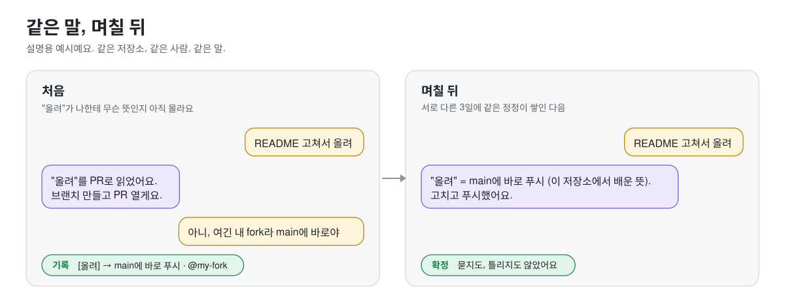
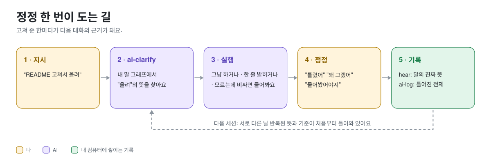
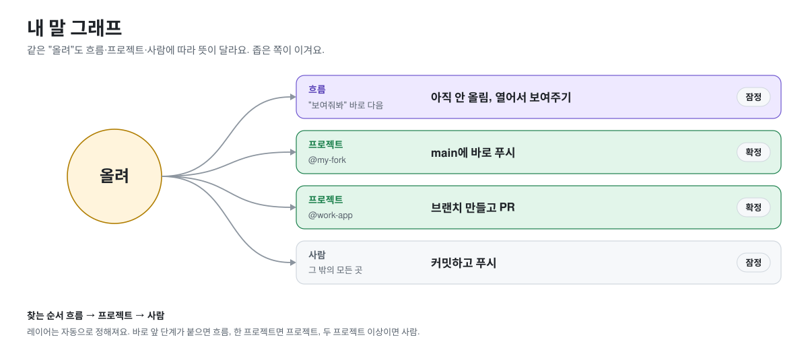

<div align="center">

# ai-criteria

### 쓸수록 내 말을 알아듣는 AI

좋다는 하네스도, 잘 쓴 프롬프트도 내 말투까지는 몰라요.<br>
ai-criteria는 내가 고쳐 준 순간을 기록해서, 대화할수록 나한테 맞춰져요.

[](LICENSE)


[빠른 시작](#빠른-시작) · [어떻게 맞춰지나](#어떻게-맞춰지나) · [비교](#다른-방법과-뭐가-달라요) · [자세히](#자세히) · [English](README.md)

</div>

<p align="center"></p>

## 빠른 시작

```
/plugin marketplace add phantomMillie/ai-criteria
/plugin install ai-criteria@ai-criteria
```

새 세션을 열고 평소처럼 쓰면 돼요. AI가 틀리면 "틀렸어", "왜 그랬어"라고만 하세요. 나머지는 알아서 쌓여요.<br>
설정도, API 키도, 패키지도 필요 없어요. Codex나 Gemini CLI도 쓴다면 아래 [자세히](#자세히)의 "Codex · Gemini CLI와 같이 쓰기"를 보세요.

## 이런 게 달라져요

<table>
<tr>
<td width="50%" valign="top">

**내 말을 배워요**<br>
"올려", "깔끔하게" 같은 말이 나한테 무슨 뜻인지 정정에서 배워요. 프로젝트마다, 바로 앞에 한 일마다 다르게요.

</td>
<td width="50%" valign="top">

**필요할 때만 물어요**<br>
모르는 말인데 되돌리기 어려운 일일 때만 물어요. 나머지는 어떻게 읽었는지 한 줄 밝히고 바로 해요.

</td>
</tr>
<tr>
<td valign="top">

**같은 실수는 기준이 돼요**<br>
서로 다른 날 반복된 원인만 기준으로 올라가요. 하루에 세 번 고친 건 한 번으로 쳐요. 반례가 나오면 지워져요.

</td>
<td valign="top">

**내 컴퓨터에만 있어요**<br>
네트워크 호출, 계정, 의존성이 없어요. 홈 폴더의 숨김 폴더 하나에 쌓이고, 어디로도 안 보내요.

</td>
</tr>
</table>

## 왜 만들었나

같은 "올려"도 누구는 커밋만, 누구는 main에 바로 푸시, 누구는 PR을 떠올려요. 같은 사람도 개인 저장소와 회사 저장소에서 다르게 쓰고, 바로 앞에 "보여줘봐"라고 했다면 아직 올리지 말라는 뜻일 수도 있어요.

이걸 미리 다 적어 둘 수는 없어요. 남이 잘 만든 하네스나 프롬프트 템플릿은 평균적인 사람에 맞춰져 있고, 메모리 노트에는 "더 꼼꼼히 하겠습니다" 같은 다짐만 쌓여요. 모호함은 없앨 수 없으니까 맞춰 가는 수밖에 없어요. 그래서 이건 처음부터 다 맞히려고 하지 않아요. 일단 하고, 내가 고쳐 주는 순간에 배워요.

## 어떻게 맞춰지나

<p align="center"></p>

자주 쓰는 말은 노드가 되고, 그 말이 실제로 뭘 뜻했는지가 연결로 쌓여요. 연결은 흐름·프로젝트·사람, 세 레이어로 나뉘고 뜻을 찾을 때는 좁은 쪽이 이겨요. 레이어는 내가 고르지 않아요. 기록이 쌓이는 모양을 보고 자동으로 정해져요.

<p align="center"></p>

**언제 물어보나.** 매번 묻지 않아요. 그래프가 아는 정도와 틀렸을 때의 비용으로 정해요.

| 그래프에서 이 말은 | 틀려도 쉽게 고침 | 틀리면 되돌리기 어려움 |
|---|---|---|
| 확정된 뜻이 있음 | 그냥 해요 | 하면서 읽은 뜻 한 줄 |
| 잠정 뜻이 있음 | 하면서 한 줄 | 하면서 한 줄 |
| 모름 · 레이어끼리 부딪힘 · 최근에 정정됨 | 하면서 한 줄 | **물어봐요** |

묻는 칸은 하나뿐이에요. 대화가 쌓일수록 말이 위쪽 칸으로 올라가니까 질문이 점점 줄어요. 되돌리기 어려운 일은 밖으로 나가는 일(푸시, PR, 배포, 전송), 지워지는 일(삭제, 덮어쓰기, `git reset`), 큰 일(여러 파일, 전면 재작성), 돈이나 권한이 걸린 일이에요. 이 기준도 "이건 물어봤어야지", "이런 건 묻지 마"라는 정정으로 내 기준으로 바뀌어요.

## 다른 방법과 뭐가 달라요

| | 하네스 · 프롬프트 템플릿 | `CLAUDE.md` · 메모리 | **ai-criteria** |
|---|---|---|---|
| 누구에게 맞춰졌나 | 평균적인 사용자 | 내가 손으로 쓴 만큼 | **내가 고쳐 준 기록** |
| 내 말버릇 | 몰라요 | 적어 둔 것만 | **정정할 때마다 배워요** |
| 프로젝트·흐름마다 다른 뜻 | 없어요 | 파일을 나눠야 해요 | **레이어로 자동** |
| 틀린 규칙 | 남아요 | 남아요 | **반례가 나오면 지워져요** |
| 질문 | 매번 묻거나 안 묻거나 | 정해진 게 없어요 | **모르는데 비쌀 때만** |

둘 중 하나를 고를 필요는 없어요. 하네스 위에 얹어서 같이 쓰면 돼요.

## 자세히

<details>
<summary><b>단계 규칙: 대기 → 잠정 → 확정 → 폐기</b></summary>

<br>

말 그래프와 기준은 같은 규칙으로 자라요. 같은 대화 안에서 반복된 건 독립된 증거가 아니라서 **서로 다른 날**만 셉니다.

| 같은 뜻 / 같은 원인이 | 어떻게 돼요 |
|---|---|
| 1번, 또는 하루에 여러 번 | 대기. 아직 안 써요 |
| 서로 다른 2일 | 잠정. 쓰되 읽은 뜻을 한 줄 밝혀요 |
| 서로 다른 3일 | 확정. 묻지 않고 써요 |
| 두 프로젝트 이상에서 | 사람 레이어 / 전역 기준으로 올라가요 |
| 반례 1번 | 확정이었으면 잠정으로 내려가요. 정정이 더 최근이면 다시 모르는 걸로 쳐요 |
| 반례 2번 | 폐기해요 |

틀린 규칙은 싸요. 문장 하나가 조금 시끄러울 뿐이에요. 늦은 규칙은 비싸요. 그동안 실수가 계속 나니까요. 그래서 잠정은 낮게, 확정은 엄격하게 잡았어요. 문턱은 `~/.ai-criteria/config.json`에서 바꿀 수 있어요.

```json
{ "provisional_min_cases": 2, "provisional_min_days": 2, "confirmed_min_cases": 3,
  "confirmed_min_days": 3, "global_min_projects": 2, "retire_counterexamples": 2,
  "rollup_nudge_at": 5, "clarify_reminder": true }
```

</details>

<details>
<summary><b>틀린 원인을 기준으로: /ai-log → /ai-rollup → /ai-criteria</b></summary>

<br>

말뜻 말고 판단 자체가 틀린 경우도 있어요. 그때는 결과가 아니라 **어디서 전제가 틀어졌는지**를 기록해요.

- ✗ `왜: 문서를 잘 안 읽음` (결과를 다시 말한 것)
- ○ `왜: 기획서 문장을 확정된 요구사항으로 전제함. 같은 항목의 "확인 필요"를 무시함`

일주일에 한 번 `/ai-rollup`을 돌리면 사례가 주차별로 정리되고, 이어서 `/ai-criteria`가 같은 '왜'를 묶어서 승격하거나 폐기해요. 기준마다 언제 적용하고 언제 무효인지가 붙어서 틀렸다고 증명될 수 있어요.

```markdown
### J-1 [confirmed]  옛 코드에는 있는데 새 코드에 없다 → "이관 안 됨"
- 적용: 입력에 제거 결정 근거(주석, 기획서, 별도 티켓)가 없을 때
- 무효: 제거 결정 근거가 하나라도 있으면 쓰지 않는다. 이관 안 됨 / 일부러 뺌 / 모름, 세 갈래로 나눈다
```

입력 기준(`I-`)은 사람이 넣어 줘야 하는 걸, 판단 기준(`J-`)은 AI가 확인해야 하는 걸 잡아요. 승격한 뒤에는 재발만 보면 돼요: `ailog.py search "<문구>" --since <승격일>`

</details>

<details>
<summary><b>결론 바로 앞에서: /ai-check</b></summary>

<br>

`ai-clarify`가 일 시작 전이라면 `ai-check`는 결론 직전이에요. 출처를 비교하거나, 개수를 세거나, "없다"고 단정하거나, 요구사항을 확정하기 직전에 돌려요. 입력 기준이 안 채워졌으면 먼저 물어보고, 판단 기준마다 무효 조건에 걸리는지 봐요.

</details>

<details>
<summary><b>쓰는 법 한눈에</b></summary>

<br>

| 이렇게 하면 | 이렇게 돼요 |
|---|---|
| "README 고쳐서 올려줘" | 내 말 그래프에서 "올려"를 찾아서 하거나, 한 줄 밝히고 하거나, 모르는데 비싸면 물어봐요 |
| "틀렸어, 그 올려는 커밋만이었어" | 사례를 기록하고 `[올려] → 커밋만` 연결을 남겨요 |
| "이건 물어봤어야지" / "이런 건 묻지 마" | 그 일이 비싼 일인지 싼 일인지 내 기준으로 기록돼요 |
| `/ai-rollup` (일주일에 한 번) | 사례가 주차별로 정리되고, 이어서 `/ai-criteria` |
| *(자동)* 새 세션 | `ai-clarify` 안내 + 이 프로젝트에서 배운 말 + 기준이 들어가요 |
| `/ai-check` | 비교·집계·확정 직전 확인 |
| `/ai-recall` | 지난 사례 검색, 배운 말 보기, 통계, 점검, 내보내기/가져오기 |

</details>

<details>
<summary><b>Codex · Gemini CLI와 같이 쓰기</b></summary>

<br>

Claude Code 플러그인을 깐 다음, 이 저장소에서 돌려요.

```bash
python3 scripts/install_shared.py
```

- 세 도구가 같은 `~/.ai-criteria`를 써요. 어느 도구에서 고쳐 줘도 다 같이 맞춰져요.
- 공용 스킬 6개가 `~/.agents/skills`에, 실행 파일이 `~/.local/share/ai-criteria`에 들어가요.
- `~/.codex/AGENTS.md`, `~/.gemini/GEMINI.md`에 관리 블록을 추가해요. 원래 지침은 그대로 두고 바꾸기 전 파일은 백업해요.
- 훅은 `~/.codex/hooks.json`, `~/.gemini/settings.json`에 합쳐지고, 다시 돌려도 중복되지 않아요.
- Codex는 `/hooks`에서 새 훅을 직접 신뢰해 줘야 돌아가요. 설치기가 대신 승인하지 않아요.
- 같은 이름의 내 스킬이 있으면 덮어쓰지 않고 멈춰요. 기록·말 그래프·기준 데이터는 건드리지 않아요.

</details>

<details>
<summary><b>데이터는 어디에 쌓이나</b></summary>

<br>

```
~/.ai-criteria/            (권한 700)
├── lexicon.jsonl          내 말 그래프 (말이 실제로 뭘 뜻했는지, 관찰 한 줄씩)
├── inbox.jsonl            롤업 기다리는 사례
├── cases/2026-W42.jsonl   주차별 사례 (+ 읽기용 .md)
├── criteria.md            지금 기준 (+ Pending, Retired)
├── config.json            문턱, clarify 안내 on/off
└── tags.json · meta.json
```

- 네트워크 호출, 텔레메트리, 계정이 없어요. 표준 라이브러리만 쓰는 파일 하나예요.
- 키·토큰·비밀번호처럼 생긴 건 저장 전에 가려요. 그래도 보장은 아니니까 비밀은 적지 마세요.
- 컴퓨터를 옮길 때는 `ailog.py export --out x.json` → `ailog.py import x.json`. 말 그래프도 같이 옮겨져요.
- 팀이랑 나눌 때는 `criteria.md`만 나눠요. 말 그래프는 사람마다 달라서 나누지 않는 게 맞아요.

</details>

<details>
<summary><b>명령어</b></summary>

<br>

```bash
python3 scripts/ailog.py hear "올려" "커밋만" --read-as "main 푸시" [--after "보여줘봐"] [--project 이름]
python3 scripts/ailog.py hear "개인 fork main 푸시" cheap --kind cost
python3 scripts/ailog.py lexicon [--phrase "올려"] [--all]
python3 scripts/ailog.py log "냈던 답" "실제" "왜" --tag wrong-premise [--project 이름]
python3 scripts/ailog.py rollup [--dry-run|--keep]
python3 scripts/ailog.py candidates
python3 scripts/ailog.py evidence <case-id> <case-id> ...
python3 scripts/ailog.py criteria [--project 이름]
python3 scripts/ailog.py search "검색어" [--tag T] [--project P] [--since 날짜]
python3 scripts/ailog.py status | stats | doctor
python3 scripts/ailog.py export [--out file.json] | import file.json
```

기본 원인 태그: `missed-evidence` · `misread-record` · `oversimplified-rule` · `stale-source` · `scope-drift` · `fabricated-number` · `wrong-premise` · `split-reading`

</details>

<details>
<summary><b>자주 묻는 것</b></summary>

<br>

**처음에는 엄청 물어보지 않아요?**<br>
아니요. 모르는 말이어도 쉽게 고칠 수 있는 일이면 읽은 뜻을 한 줄 밝히고 그냥 해요. 묻는 건 모르는 말인데 되돌리기 어려운 일일 때뿐이에요.

**컨텍스트를 많이 먹어요?**<br>
세션 시작 때 `ai-clarify` 안내 한 문단, 그리고 이 프로젝트에 해당하는 잠정·확정된 말과 기준만 들어가요. 대기·다툼·폐기 상태는 안 들어가요.

**정정 감지가 헛짚으면요?**<br>
훅은 모든 프롬프트에 짧은 신호만 줘요. 단어 목록으로 거르지 않아요. 말투·욕·언어가 사람마다 달라서 목록으로는 못 잡거든요. 판단은 모델이 해요. 그냥 질문이나 일반 요청이면 무시해서 기록이 안 생겨요.

**`ai-clarify` 안내를 끄고 싶어요.**<br>
`~/.ai-criteria/config.json`에 `"clarify_reminder": false`를 넣으면 돼요.

</details>

## 기여

이슈와 PR 언제든 환영해요. 테스트는 `python3 -m unittest discover -s tests -v`로 돌려요. 바뀐 내용은 [CHANGELOG](CHANGELOG.md)에 있어요.

## 라이선스

[MIT](LICENSE)
