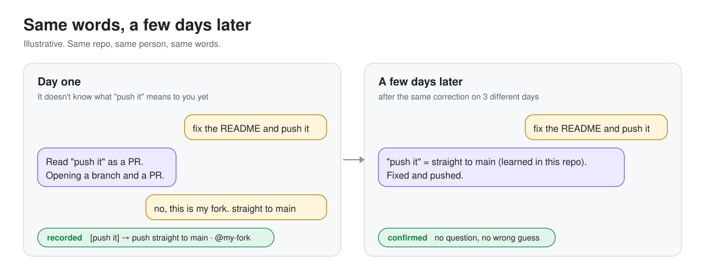
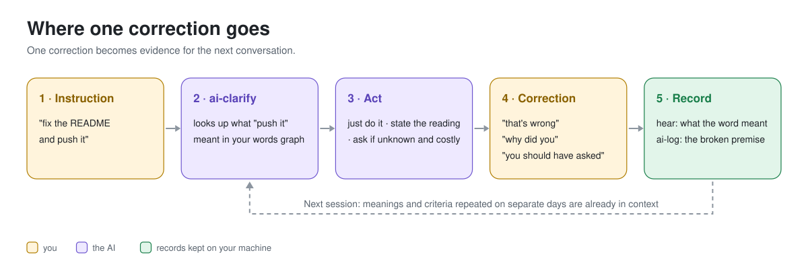
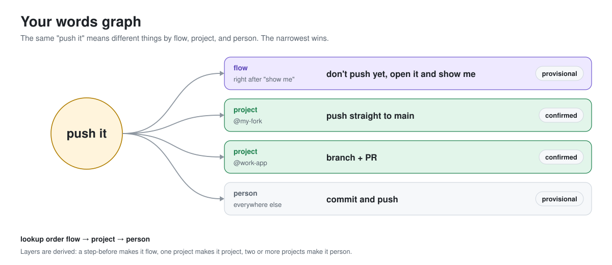

<div align="center">

# ai-criteria

### An AI that understands you better the more you use it

The best harness and the best-written prompt still don't know how *you* talk.<br>
ai-criteria records the moments you correct your AI, so every conversation fits you a little better.

[](LICENSE)


[Quick start](#quick-start) · [How it fits to you](#how-it-fits-to-you) · [Compared](#how-is-this-different) · [Details](#details) · [한국어](README.ko.md)

</div>

<p align="center"></p>

## Quick start

```
/plugin marketplace add phantomMillie/ai-criteria
/plugin install ai-criteria@ai-criteria
```

Start a new session and work as usual. When the AI gets something wrong, just say "that's wrong" or "why did you do that." The rest builds up on its own.<br>
No config, no API keys, no packages. Using Codex or Gemini CLI too? See "Use it with Codex and Gemini CLI" under [Details](#details).

## What changes

<table>
<tr>
<td width="50%" valign="top">

**It learns your words**<br>
What "push it" or "clean it up" means to you, learned from your corrections. Per project, and per what you did right before.

</td>
<td width="50%" valign="top">

**It asks only when it matters**<br>
Only when a word is unknown and the action is hard to undo. Otherwise it states how it read you in one line and gets going.

</td>
</tr>
<tr>
<td valign="top">

**Repeat mistakes become criteria**<br>
Only root causes that repeat on different days get promoted. Three corrections in one afternoon count once. Counter-examples delete them.

</td>
<td valign="top">

**It stays on your machine**<br>
No network calls, no accounts, no dependencies. One hidden folder in your home directory, sent nowhere.

</td>
</tr>
</table>

## Why this exists

"Push it" means just commit to one person, straight to main to another, a PR to someone else. The same person uses it differently in a personal repo and at work, and right after "show me" it might mean *don't push yet*.

You can't write all of that down ahead of time. A well-made harness or prompt template is tuned for the average person, and memory notes fill up with vows like "I'll be more careful." Ambiguity doesn't go away, so the only way through is to fit to it. That's why this doesn't try to get everything right up front. It acts, and learns the moment you correct it.

## How it fits to you

<p align="center"></p>

Words you use often become nodes, and what they actually meant becomes links. Links live in three layers (flow, project, person), and the narrowest one wins. You don't pick the layer; it's derived from how the records pile up.

Words link to words, too. When the AI reads "clean this up" through the learned word "clean" and you don't correct it, a `"clean this up" ≈ "clean"` relation is recorded: the AI's own reading becomes data. Repeated on other days it hardens, and next time the lookup walks from the new word to the learned one by itself. A correction breaks the link. So your words graph spreads the way you actually work.

<p align="center"></p>

**When it asks.** Not every time. It looks at what the graph knows and what a wrong guess would cost.

| What the graph says about this word | Wrong guess is easy to fix | Wrong guess is hard to undo |
|---|---|---|
| a confirmed meaning | just does it | does it, states the reading in one line |
| a provisional meaning | does it, one line | does it, one line |
| unknown · layers conflict · recently corrected | does it, one line | **asks** |

Only one cell asks. As you talk more, words move up the table, so questions keep dropping. Hard to undo means it goes out (push, PR, deploy, send), deletes (remove, overwrite, `git reset`), is large (many files, a full rewrite), or touches money or permissions. Corrections like "you should have asked" or "don't ask about that" turn these defaults into yours.

## How is this different

| | Harness · prompt templates | `CLAUDE.md` · memory | **ai-criteria** |
|---|---|---|---|
| Fitted to | the average user | whatever you wrote by hand | **your own corrections** |
| Your habits | unknown | only what you wrote down | **learned on every correction** |
| Meaning by project or flow | none | split the files yourself | **layers, automatically** |
| Wrong rules | stay | stay | **deleted by counter-examples** |
| Questions | always or never | undefined | **only when unknown and costly** |

You don't have to choose. Put it on top of your harness and use both.

## Details

<details>
<summary><b>Tiers: pending → provisional → confirmed → retired</b></summary>

<br>

Words and criteria grow by the same rules. Repeats inside one conversation aren't independent evidence, so only **different days** count.

| The same meaning / root cause | What happens |
|---|---|
| once, or many times in one day | pending. A word is used already, with the reading stated in one line so you can fix it; a criterion is not |
| on 2 different days | provisional: used, with the reading stated in one line |
| on 3 different days | confirmed: used without asking |
| in 2+ projects | moves up to the person layer / a global criterion |
| 1 counter-example | a confirmed one drops to provisional; if the correction is newer, it counts as unknown again |
| 2 counter-examples | retired |

A wrong rule is cheap: one slightly noisy sentence. A late rule is expensive: the mistake keeps happening. So provisional is low and confirmed is strict. Tune thresholds in `~/.ai-criteria/config.json`:

```json
{ "provisional_min_cases": 2, "provisional_min_days": 2, "confirmed_min_cases": 3,
  "confirmed_min_days": 3, "global_min_projects": 2, "retire_counterexamples": 2,
  "rollup_nudge_at": 5, "clarify_reminder": true }
```

</details>

<details>
<summary><b>Root causes become criteria: /ai-log → /ai-rollup → /ai-criteria</b></summary>

<br>

Sometimes it isn't a word's meaning but the judgment that went wrong. Then it records **where the premise broke**, not the outcome.

- ✗ `why: misread the doc` (just restates the outcome)
- ○ `why: treated a spec sentence as a confirmed requirement; ignored the "to be confirmed" note in the same item`

Run `/ai-rollup` once a week. Cases move into weekly files and `/ai-criteria` clusters the same whys, then promotes or retires them. Every criterion says when it applies and when it's void, so it can be proven wrong.

```markdown
### J-1 [confirmed]  In the old source but not the new one → "not migrated"
- Applies when: the input has NO removal-decision source (comment, spec, separate ticket)
- Void when:    any removal-decision source exists. Use 3 buckets: not migrated / removed on purpose / unknown
```

Input criteria (`I-`) catch what you need to supply; judgment criteria (`J-`) catch what the AI needs to verify. After promotion, only recurrence matters: `ailog.py search "<phrase>" --since <promotion date>`

</details>

<details>
<summary><b>Right before concluding: /ai-check</b></summary>

<br>

`ai-clarify` runs before the work. `ai-check` runs right before the conclusion: before comparing sources, counting, declaring something "missing," or freezing requirements. If an input criterion isn't met, it asks first, then checks each judgment criterion's void-when.

</details>

<details>
<summary><b>Usage at a glance</b></summary>

<br>

| You do | What happens |
|---|---|
| "fix the README and push it" | It looks "push it" up: does it, states the reading, or asks if unknown and costly |
| "wrong, by push it I meant just commit" | It logs the case and links `[push it] → just commit` |
| "you should have asked" / "don't ask about that" | That action is recorded as costly or cheap, for you |
| `/ai-rollup` (weekly) | Cases go into weekly files, then straight into `/ai-criteria` |
| *(automatic)* new session | The `ai-clarify` note + words learned in this project + criteria |
| `/ai-check` | A check right before comparing, counting, or freezing |
| `/ai-recall` | Search past cases, see learned words, stats, health check, export/import |

</details>

<details>
<summary><b>Use it with Codex and Gemini CLI</b></summary>

<br>

Nothing extra to do. Install the Claude Code plugin and start it once: on a machine with a `~/.codex` or `~/.gemini` folder, the session start also installs the Codex and Gemini side.

Using Codex or Gemini without Claude Code? Clone this repository and run it once:

```bash
python3 scripts/install_shared.py
```

- All three share `~/.ai-criteria`, so a correction in any of them fits all of them.
- Six portable skills go into `~/.agents/skills` and Antigravity global discovery (`~/.gemini/config/skills`, `~/.gemini/config/skills.json`), the runtime into `~/.local/share/ai-criteria`.
- A managed block is added to `~/.codex/AGENTS.md` and `~/.gemini/GEMINI.md`. Existing instructions stay and the old files are backed up.
- Hooks are merged into `~/.codex/hooks.json` and `~/.gemini/settings.json`. Re-running doesn't duplicate anything.
- Every plugin update is applied to the Codex and Gemini copies at the next Claude Code session start.
- In Codex, trust the new hooks with `/hooks`. The installer never grants trust for you.
- If you already have your own skill with the same name, it stops instead of overwriting. It never touches your cases, words, or criteria.

Skill discovery and filesystem access are separate. The installer generates `~/.local/share/ai-criteria/codex-permissions.toml` using this machine's home directory (or the configured `AI_CRITERIA_HOME`). It does **not** silently change Codex approval policy or enable full access. To grant only the shared data directory in legacy workspace-write settings, opt in with Python 3.11+:

```bash
python3 scripts/install_shared.py --configure-codex-permissions
```

The optional merge preserves existing model, network, approval and other write-root settings and backs up `config.toml`. Existing read-only modes or named permission profiles are not replaced: configure the selected profile or app permission mode explicitly. Managed/session rules can still override user config. Restart Codex and trust the hooks in `/hooks`; saying “I grant permission” in a chat does not change its sandbox. Installation and the test suite require Python 3.9+; the opt-in TOML merge requires Python 3.11+. No local cases, learned words, or criteria are bundled or uploaded.


</details>

<details>
<summary><b>Where your data lives</b></summary>

<br>

```
~/.ai-criteria/            (mode 700)
├── lexicon.jsonl          your words graph (what a word actually meant, one observation per line)
├── inbox.jsonl            cases waiting for rollup
├── cases/2026-W42.jsonl   weekly cases (+ readable .md)
├── criteria.md            your current criteria (+ Pending, Retired)
├── config.json            thresholds, clarify note on/off
└── tags.json · meta.json
```

- No network calls, no telemetry, no accounts. It's one stdlib-only file.
- Things shaped like keys, tokens, and passwords are masked before saving. That's a safety net, not a guarantee, so don't write secrets.
- Moving machines: `ailog.py export --out x.json` → `ailog.py import x.json`. Your words come along.
- Sharing with a team: share `criteria.md` only. A words graph is personal.

</details>

<details>
<summary><b>CLI</b></summary>

<br>

```bash
python3 scripts/ailog.py hear "push it" "just commit" --read-as "push to main" [--after "show me"] [--project name]
python3 scripts/ailog.py hear "push to personal fork main" cheap --kind cost
python3 scripts/ailog.py lexicon [--phrase "push it"] [--all]
python3 scripts/ailog.py log "gave" "actual" "why" --tag wrong-premise [--project name]
python3 scripts/ailog.py rollup [--dry-run|--keep]
python3 scripts/ailog.py candidates
python3 scripts/ailog.py evidence <case-id> <case-id> ...
python3 scripts/ailog.py criteria [--project name]
python3 scripts/ailog.py search "query" [--tag T] [--project P] [--since DATE]
python3 scripts/ailog.py status | stats | doctor
python3 scripts/ailog.py export [--out file.json] | import file.json
```

Default root-cause tags: `missed-evidence` · `misread-record` · `oversimplified-rule` · `stale-source` · `scope-drift` · `fabricated-number` · `wrong-premise` · `split-reading`

</details>

<details>
<summary><b>FAQ</b></summary>

<br>

**Won't it ask a ton of questions at first?**<br>
No. Even with an unknown word, if the action is easy to fix it states its reading in one line and goes ahead. It only asks when the word is unknown *and* the action is hard to undo.

**Will it bloat my context?**<br>
A short `ai-clarify` paragraph at session start, plus this project's words (pending ones too, marked so the model states the reading) and its provisional/confirmed criteria. Contested and retired items are never injected.

**Why does it say my word back after a correction?**<br>
What it wrote down is your word, so you get to see it: `"올려" = push to origin main, got it.` Fix the form or the meaning right there and it records the fix. The same word written three ways would never add up, so `ai-rollup` also proposes merging variants (`variants` / `merge-word`) and merges only on your yes.

**Can I speed it up by telling it my wording in advance?**<br>
No, that tangles it. Words are learned only from corrections during real work. An answer given in the abstract ("what does 'clean up' usually mean to you?") disagrees with how you actually use the word later, ends up contested, and only makes the injected list longer. Just work as usual and correct it when it is wrong.

**What about false positives from the correction detector?**<br>
The hook only raises a short signal on every prompt; it does not filter by keywords, because wording, slang and language differ for every user. The model decides. Plain questions and ordinary requests are ignored, so nothing gets logged.
It fires on pushback wording, including implicit Korean pushback like `~다며`, `~잖아` and `;;`, and when you paste back part of a recent answer with a short reaction.

**How do I turn off the `ai-clarify` note?**<br>
Set `"clarify_reminder": false` in `~/.ai-criteria/config.json`.

</details>

## Contributing

Issues and PRs are always welcome. Run the tests with `python3 -m unittest discover -s tests -v`. See the [CHANGELOG](CHANGELOG.md).

## License

[MIT](LICENSE)
